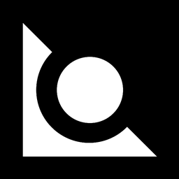

<div align="center">



# V I S O R

**An AI gate-camera that sees who's riding without a helmet, and remembers the plate.**

<br/>


<br/>

`detect` &nbsp;·&nbsp; `track` &nbsp;·&nbsp; `verify` &nbsp;·&nbsp; `read` &nbsp;·&nbsp; `log`

</div>

<br/>

---

## ◐ &nbsp;What is Visor?

Visor watches a video feed (a file, a webcam or a CCTV stream), picks out every motorcycle, and decides whether its rider is wearing a helmet. If not, it reads the number plate, saves a snapshot as evidence, and writes everything to a database you can browse in a dark, minimal web dashboard.

It is built for **campus gates, parking entrances and traffic studies**, anywhere you want to *measure* helmet compliance instead of guessing.

> **Demo** &nbsp;→ &nbsp;_drop a GIF or video link here_

<br/>

## ◑ &nbsp;How it sees

```
   ┌──────────────┐
   │ video / CCTV │
   └──────┬───────┘
          ▼
   ┌────────────────────────┐
   │ YOLO + ByteTrack       │   one stable ID per motorcycle
   └──────┬─────────────────┘
          ├──► helmet model   ──►  helmet  /  no_helmet
          ├──► plate model    ──►  licence-plate box
          ▼
   ┌────────────────────────┐
   │ link to the rider zone │   detections belong to the right bike
   └──────┬─────────────────┘
          ▼
   ┌────────────────────────┐
   │ vote across frames     │   a violation needs consistent evidence,
   └──────┬─────────────────┘   not one unlucky frame
          ▼
   ┌────────────────────────┐
   │ EasyOCR + format fix   │   best crops, voted into one plate
   └──────┬─────────────────┘
          ▼
   SQLite  +  snapshots  ──►  Streamlit dashboard
```

**Why it's not twitchy:** a rider is only flagged after several frames of confident "no helmet" evidence, and a bike that briefly leaves the frame keeps its identity. Every threshold lives in `config.yaml`.

<br/>

## ◒ &nbsp;Features

| | |
|---|---|
| 🛵 **Rider tracking** | One persistent ID per motorcycle with ByteTrack |
| 🪖 **Helmet check** | Frame-voting to avoid false alarms from a single bad frame |
| 🔤 **Plate reading** | Best crops per vehicle, OCR with format correction and voting |
| 🚗 **Other vehicles** | Optionally logs plates of cars, buses and trucks too (no helmet check) |
| 🗂️ **Evidence log** | Snapshot, plate and timestamp for every violation in SQLite |
| 🖥️ **Dashboard** | Review video, violations table, evidence gallery and analytics |
| ⚡ **Tunable** | Confidence thresholds, frame skipping and GPU toggle in one YAML file |

<br/>

## ◓ &nbsp;Quick start

**1 &nbsp;Install**

```bash
python -m venv .venv
source .venv/bin/activate          # Windows: .venv\Scripts\activate
pip install -r requirements.txt
```

**2 &nbsp;Get data** &nbsp;_(free)_

Search **Roboflow Universe** (or Kaggle) for *"helmet detection"* and *"license plate"*. Download each as **YOLOv8 format** and unzip into:

```
datasets/helmet/
datasets/plate/
```

Open each `data.yaml`, note the class names, and match them in `config.yaml` under `helmet_names` / `no_helmet_names`.

**3 &nbsp;Train the two models**

No GPU? Run this in a free Google Colab notebook.

```bash
python -m src.train --data datasets/helmet/data.yaml --name helmet --epochs 50
python -m src.train --data datasets/plate/data.yaml  --name plate  --epochs 50
```

Weights land in `models/helmet.pt` and `models/plate.pt`.

**4 &nbsp;Run it**

```bash
python -m src.pipeline --source videos/test.mp4 --save-video
```

| Source | Flag |
|---|---|
| Video file | `--source videos/test.mp4` |
| Webcam | `--source 0` |
| CCTV / RTSP | `--source rtsp://...` |
| Live preview window | add `--show` |

**5 &nbsp;Open the dashboard**

```bash
streamlit run app/dashboard.py
```

<br/>

## ◔ &nbsp;Dashboard

| Tab | What you get |
|---|---|
| **Review** | The annotated video, with jump-to-violation controls |
| **Violations** | A searchable table of every logged event |
| **Evidence** | A gallery of violation snapshots |
| **Analytics** | Trends and counts over time |

<br/>

## ◕ &nbsp;Project layout

```
Visor/
├── app/
│   ├── dashboard.py        Streamlit dashboard
│   └── assets/             logo + favicon
├── src/
│   ├── pipeline.py         detection → tracking → voting → logging
│   ├── ocr.py              plate reader
│   ├── db.py               SQLite storage
│   ├── train.py            model training
│   ├── merge_datasets.py   combine several datasets into one
│   └── utils.py
├── tests/
├── models/                 your trained weights go here
├── config.yaml             all the knobs
└── requirements.txt
```

<br/>

## ● &nbsp;Tuning

Everything lives in `config.yaml`.

| Setting | What it does |
|---|---|
| `helmet_conf`, `no_helmet_conf`, `plate_conf` | Minimum confidence per detector |
| `min_violation_frames` | Frames of "no helmet" before a rider counts |
| `violation_ratio` | Share of helmet evidence that must be "no helmet" |
| `lost_frames` | How long a bike may vanish before it's finalized |
| `frame_skip` | Process every Nth frame for speed |
| `gpu` | Turn CUDA on or off |

<br/>

## ○ &nbsp;Results

_Fill these in with your own measured numbers._

| Component | Metric | Value |
|---|---|---|
| Helmet model | mAP50 | _TBD_ |
| Plate model | mAP50 | _TBD_ |
| Plate OCR | exact-match accuracy on N test crops | _TBD_ |
| End-to-end | violations found vs. manually counted | _TBD_ |

<br/>

## ◌ &nbsp;Limitations

- Plate reading degrades at night, with motion blur, or at steep camera angles.
- Helmet detection can miss riders who are occluded or far from the camera.
- Plates are validated against the Indian format; other formats fall back to raw OCR text.

<br/>

## ◍ &nbsp;Privacy & ethics

Visor processes video of real people. Get permission from your institution before recording, store snapshots securely, and blur faces and plates in any public demo.

<br/>

## ◎ &nbsp;Tests

```bash
pip install pytest && pytest -q
```

<br/>

---

<div align="center">

<sub>Built with Ultralytics YOLO · ByteTrack · OpenCV · EasyOCR · SQLite · Streamlit</sub>

</div>
